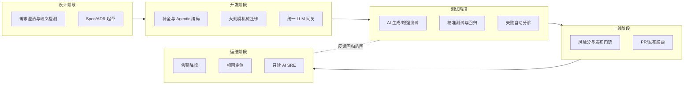

# 01 · AI 融入研发生命周期全景：系统设计 / 开发 / 测试 / 运维上线

> 本篇是 `ai-sdlc` 方向的总览：先给一条被各方数据共同指向的"主叙事"，再按 SDLC 五个阶段（设计/开发/测试/上线/运维）整理 AI 的典型用法与一手落地证据。回归保护、前后端联动、AI 判定、业务流程、需求识别五个专题分别在 02~06 篇展开；踩坑集中在 07 篇；落地路线图在 08 篇。
>
> 条款编号前缀【S1.#】。调研方法与全部来源验证状态见 [09-参考资料.md](09-参考资料.md)，四路调研原始底稿在 [research/](research/)。

---

## S1.1 一条主叙事：五个被反复验证的事实

2024–2026 年的大厂一手数据与第三方研究，共同指向一个"矛盾统一"的图景：

**事实 1：采用速度极快。** Google 公开口径新代码 25%+ 由 AI 生成（2024 Q3 财报电话会，【⚠️抓不到-搜索摘要可用】，报道见 https://www.moneycontrol.com 等）；Uber 84% 工程师是 agentic coding 用户、11% 的 PR 由 agent 发起（https://newsletter.pragmaticengineer.com/p/how-uber-uses-ai-for-development ，【已验证】）；腾讯 90%+ 工程师使用 CodeBuddy（2025 腾讯研发大数据报告口径，【未验证-仅搜索可见】）；阿里云内部月活占比超 82%、每日 AI 生成代码占总提交 30%+（阿里云披露，【未验证-仅搜索可见】）。

**事实 2：局部（任务级）提速确凿。** GitHub 官方 RCT：95 名职业开发者写同一个 HTTP 服务器，Copilot 组快 55%（https://github.blog/news-insights/research/research-quantifying-github-copilots-impact-on-developer-productivity-and-happiness/ ，【已验证】）；Airbnb 用 LLM 做 3,500 个测试文件框架迁移，1.5 年人工量压到 6 周（https://medium.com/airbnb-engineering/accelerating-large-scale-test-migration-with-llms-9565c208023b ，【已验证】）；Google 内部 39 次 LLM 迁移 ~74% 代码变更由 AI 生成、迁移时间省约 50%（https://arxiv.org/abs/2504.09691 ，【已验证】）。

**事实 3：端到端收益存疑，主观感知严重失真。** METR 随机对照实验：16 名资深开源开发者在熟悉的大型代码库上用 AI（Cursor+Claude）反而**慢 19%**，且当事人事前预计能快 24%、事后仍自认为快了 20%（https://metr.org/blog/2025-07-10-early-2025-ai-experienced-os-dev-study/ ，【已验证】）。Uplevel 观察约 800 名开发者：无显著产出收益、PR 中 bug 率上升 41%（【⚠️抓不到-搜索摘要可用】）。**结论：厂商与个人的"我感觉快了"不可作为 ROI 证据，必须上客观基线测量。**

**事实 4：系统性代价已经量化。** DORA 2024：AI 提升个体生产力，但交付吞吐与稳定性双降（AI 采用度增加 25% 伴随交付稳定性下降约 7.2%）（https://dora.dev/research/2024/dora-report/ ，【已验证】）；GitClear 对 2.11 亿行代码的测量：2024 年 5 行以上重复代码块频率一年增长 8 倍，复制粘贴行数首次超过"移动"（moved，DRY 的标志指标），重构行为持续下降（https://leaddev.com/software-quality/how-ai-generated-code-accelerates-technical-debt ，【已验证】）。DORA 2025 给出定性结论：**AI 是放大器（amplifier），放大组织既有的优势与 dysfunction——回报来自底层组织系统而非工具本身**（https://dora.dev/research/2025/dora-report/ ，【已验证】）。

**事实 5：运维/上线是 AI-as-SRE 的下一个主战场。** 微软 RCACopilot 真实云事件根因分析准确率 0.766、诊断组件已用 4 年+（https://arxiv.org/abs/2305.15778 ，【已验证】）；K8sGPT、HolmesGPT 开源生态成熟（https://github.com/k8sgpt-ai/k8sgpt 、https://github.com/robusta-dev/holmesgpt ，【已验证】）；国内落地共识是"大模型 + 传统规则/算法 + 自动化工具"组合，而非让 LLM 直接全权操作（多篇国内实践，【未验证-仅搜索可见】）。

---

## S1.2 全生命周期地图

（本图与全篇架构图均为 Mermaid 内嵌；本方向所有图已过 `validate_and_render` 验证。）

---

## S1.3 设计阶段（系统设计 / 架构 / ADR）

**S1.3.1 Spec 驱动取代 Vibe Coding。** Amazon Kiro 在写代码前先生成 Requirements → Design → Tasks 三类 spec 文档，并用"自动化推理"检查需求的矛盾与缺口，用 property-based tests 捕获"单测通过但生产出错"的边界（https://kiro.dev/ ，【已验证】）；GitHub Spec Kit 给出 `/specify → /plan → /tasks → /implement` 四阶段工作流，口号是"从 code is the source of truth 转向 intent is the source of truth"（https://github.blog/ai-and-ml/generative-ai/spec-driven-development-with-ai-get-started-with-a-new-open-source-toolkit/ ，【已验证】）。详见 05 篇与踩坑（S7.5：SDD 的过度文档化与"瀑布复活"争议）。

**S1.3.2 设计阶段 AI 的正确定位。** 不是替人做架构决策，而是把隐性共识**显性化**：美团 31 万行 AI 重构复盘的核心方法论是"先人人对齐、再人机对齐"——人的共识先固化为 AI Rule/Skill 并前置到预 CR，"顺序错了，AI Rule 写得再好也是一纸空文"（https://tech.meituan.com/2026/05/07/Agent-AI-Coding.html ，【已验证】）。

**S1.3.3 需求上下文工程。** Uber 把源码/文档/Slack/JIRA 接成 agent 的内部上下文层（四层架构之一），Shopify 让 AI 摄取 GitHub/Slack 自动起草项目周报、人批判性改写（一半周报无需修改）（https://newsletter.pragmaticengineer.com/p/how-uber-uses-ai-for-development 、https://www.firstround.com/ai/shopify ，均【已验证】）。

---

## S1.4 开发阶段

**S1.4.1 补全仍是采纳绝对主力。** 通义灵码线上几十万用户数据：被采纳代码中 73% 来自补全、27% 来自问答（阿里云披露，【未验证-仅搜索可见】）——"问答式开发"的实际占比远小于发布会叙事。

**S1.4.2 Agentic 编码与多 agent 并行成为新工作流。** Uber：92% 开发者每月用 agents，官方工作建议是"等一个 agent 时再启动一个后台 agent"；专用 agents 各司其职——uReview（代码审查）、Autocover（每月生成 5,000+ 单测）、Shepherd（大规模迁移）、Code Inbox（PR 智能路由）（https://newsletter.pragmaticengineer.com/p/how-uber-uses-ai-for-development ，【已验证】）。

**S1.4.3 统一 LLM 网关是平台化标配。** Uber GenAI API Gateway 集中实现 guardrails、PII 脱敏、幻觉检测、限流与审计日志（https://www.uber.com/us/en/blog/the-transformative-power-of-generative-ai ，【已验证】）。

**S1.4.4 大规模机械迁移是 ROI 最确定的场景。** Airbnb Enzyme→RTL 测试迁移（1.5 年→6 周，长尾 3% 人工收尾更便宜）；Amazon Q Developer 内部 Java 升级节省 4,500 开发者年、约 $2.6 亿/年（【⚠️抓不到-搜索摘要可用】）；Meta 千万行 Java→Kotlin 迁移（Kotlinator）——**重要纠偏：它是规则+AST 工具而非 LLM，"能用确定性工具就别用 LLM"**（https://engineering.fb.com/2024/12/18/android/translating-java-to-kotlin-at-scale/ ，【已验证】）。

**S1.4.5 90%+ AI 生成代码的系统需要配套机制。** 美团复盘：AI 会"加速腐化没有规范的大代码库"，必须配套架构规范 + AI Rule + Pre-PR AI 多轮自查 + 高配模型当 Judge 审低阶模型/跨厂商互审（https://tech.meituan.com/2026/05/07/Agent-AI-Coding.html ，【已验证】）。

---

## S1.5 测试阶段

**S1.5.1 "测试改进"优于"测试生成"。** Meta TestGen-LLM 不从零生成、只改进存量测试，且每条建议必须过硬过滤器（构建通过→稳定通过→覆盖率提升），最终 73% 建议被工程师接受合入生产（https://arxiv.org/abs/2402.09171 ，【已验证】）。

**S1.5.2 单测是 AI 代码的验证层，三种姿势。** 美团：①先实现后验证（17 个单测暴露 AI 写的 `Objects.equals(Boolean.TRUE, 1)` 恒 false 类肉眼难察觉 bug）；②改存量前先建测试安全网（"开启辅助驾驶前先系安全带"）；③TDD 驱动（纯提示词 3 轮全失败，改用测试定义业务规则后 AI 一次通过）（https://tech.meituan.com/2025/12/05/AI-Coding-Unit-Testing.html ，【已验证】）。

**S1.5.3 失败自动分诊已工业化。** Google 用 LLM 诊断集成测试失败：71 个真实故障人工评估准确率 90.14%，全公司部署于代码审查系统 Critique、已服务 52,635 个失败测试（https://arxiv.org/abs/2604.12108 ，【已验证】）。

**S1.5.4 反例（踩坑）。** 美团实战证伪"全自动生成测试用例"路线：AI 缺全局业务认知、漏隐性高危场景，必须人工主导测试范围（https://tech.meituan.com/2026/05/07/Agent-AI-Coding.html ，【已验证】）。详见 02 篇与 07 篇。

---

## S1.6 上线阶段（发布 / 变更）

**S1.6.1 风险分驱动的发布门禁已有大厂样板。** Meta Diff Risk Score（DRS）：微调 Llama 对代码变更产出风险分与高风险片段，19 个用例覆盖测试选择、评审人选择、发布风险分析；2024 年某大型活动冻结期 10,000+ 变更合入"minimal production impact"，官方称 DRS"eliminate major code freezes"（https://engineering.fb.com/2025/08/06/developer-tools/diff-risk-score-drs-ai-risk-aware-software-development-meta/ ，【已验证】）。

**S1.6.2 AI 生成 PR/发布文档，人审聚焦业务语义。** 美团 Pre-PR 机制：AI 多轮自查 + AI 生成 PR 文档，人工 CR 只聚焦业务语义——对冲 AI 压缩编码时间后 CR 变瓶颈的"木桶效应"（https://tech.meituan.com/2026/05/07/Agent-AI-Coding.html ，【已验证】）。

**S1.6.3 CI 失败自动分类。** Uber HackDayz 原型：区分用户错误 vs 基础设施错误，减少"红构建"浪费；同类需求还包括评审意见自动处理（平均每 PR 约 60 分钟花在处理 review 评论）（https://www.uber.com/us/en/blog/the-transformative-power-of-generative-ai ，【已验证】）。

**S1.6.4 灰度/Canary 分析的独立量化数据仍缺。** 国内实践多归入"智能变更检测"（美团 AIOps 事件管理篇），值得继续追踪（【未验证-仅搜索可见】）。

---

## S1.7 运维阶段（On-call / 告警 / 根因）

**S1.7.1 告警降噪是第一落点。** Gartner 口径传统运维无效告警超 80%；降噪与关联压缩是国内 AIOps 共识的第一步（多篇国内实践汇总，【未验证-仅搜索可见】）。

**S1.7.2 根因定位：建议而非决策。** Microsoft RCACopilot 准确率 0.766，产品形态定位是"自动给出根因建议 + 人做最终判断"（https://arxiv.org/abs/2305.15778 ，【已验证】）；K8sGPT 把 SRE 经验编码成 analyzer + AI 解释，官方建议生产关键环境用本地模型、提供 `--anonymize` 脱敏（https://github.com/k8sgpt-ai/k8sgpt ，【已验证】）。

**S1.7.3 AI SRE 的安全边界共识：只读诊断 + 审批化写操作。** HolmesGPT 默认只读并遵循 RBAC，接 Prometheus/Grafana/Datadog/PagerDuty/Jira/ServiceNow 做根因调查，结论写回 Slack/Jira（https://github.com/robusta-dev/holmesgpt ，【已验证】）；PagerDuty 2025-10 发布端到端 AI agent 套件（SRE Agent 把原始事件转为绑定服务/文件的风险信号，在发布周期更早处拦截）（https://www.pagerduty.com/ ，【未验证-仅搜索可见】）。

**S1.7.4 国内三条主流路径。** ①告警降噪与关联压缩；②LLM+RAG/知识库做根因分析（Dify 等低代码平台，宣称根因定位小时级→分钟级）；③运维 Agent 故障自愈（智能告警→诊断→自动重启/扩容/回滚）。美团 AIOps 事件管理篇覆盖事前预防/事中处理/事后运营（均【未验证-仅搜索可见】，底稿见 research/A）。

---

## S1.8 组织机制：三家制度化样本

**S1.8.1 Shopify——把 AI 使用写进制度。** CEO memo 宣布"reflexive AI usage is now a baseline expectation"；新增 headcount 必须先证明 AI 做不了；默认允许用最贵的模型（"不默认 yes 就是默认 no"）；"MCP everything"；AI 用得好坏进 360 绩效；实习名额 25→1000（把实习生当"AI 半人马"）（https://www.firstround.com/ai/shopify ，【已验证】）。

**S1.8.2 Uber——平台层 + 自发传播。** 自建四层架构（内部 AI 平台 → 内部上下文 → 行业工具 → 专用 agents）；官方直言：自上而下强制推广效果不如自发成功案例传播；AI 成本一年涨 6 倍，token 优化成优先事项（https://newsletter.pragmaticengineer.com/p/how-uber-uses-ai-for-development ，【已验证】）。

**S1.8.3 美团——评测思路管理 AI Coding。** 用 Agent 评测系统管理 31 万行 AI 生成代码：专家经验定向 + AI 穷举扫描梳理技术债；主 R 打样 → SOP 分发 → 全组并行"零排期重构"（https://tech.meituan.com/2026/05/07/Agent-AI-Coding.html ，【已验证】）。

---

## S1.9 如何读"提效 X%"：口径陷阱速查

| 口径 | 数字 | 出处与状态 |
|---|---|---|
| 任务级 RCT | Copilot 快 55% | GitHub 官方实验，单文件单任务【已验证】 |
| 端到端 RCT | 资深开发者**慢 19%**（自以为快 20%） | METR，熟悉大型代码库【已验证】 |
| 交付级观察 | 无显著收益 + PR bug 率 +41% | Uplevel【⚠️抓不到】 |
| 交付稳定性 | AI 采用 +25% → 稳定性 -7.2% | DORA 2024【已验证】 |
| 代码质量 | 重复代码块频率一年 ×8 | GitClear，2.11 亿行【已验证】 |
| 国内单项目 | 手游项目研发效率 +10%+ | 腾讯财报口径【未验证】 |
| 迁移专项 | 1.5 年→6 周 / 省 50% | Airbnb / Google【已验证】 |

**判读规则：** ①任务级提速 ≠ 交付级提速 ≠ 组织级收益；②"使用率 90%" ≠ "提效率"；③各家"采纳率"定义不一（按键接受 ≠ 最终保留），不能横比；④开发者自报数据系统性失真（METR），只信客观基线；⑤迁移/测试等"机械可验证"任务的数字最可信，创作型任务的数字最可疑。详见 07 篇 S7.1。

---

## 本篇小结

1. AI 已渗透 SDLC 全阶段，但价值分布极不均匀：**机械可验证的任务（迁移、测试改进、失败分诊、告警降噪）ROI 最确定；创作型任务（架构决策、需求发明）只能做助手。**
2. 组织层面的先行者把 AI 当**组织系统工程**（制度、平台、Rule、评测）而非工具采购——DORA 2025 的"放大器"结论是权威背书。
3. 落地顺序：先建客观度量基线（lead time、churn、变更失败率、逃逸率），再引入 AI 并复测——否则无法区分"真提效"与"感觉提效"（08 篇展开）。
