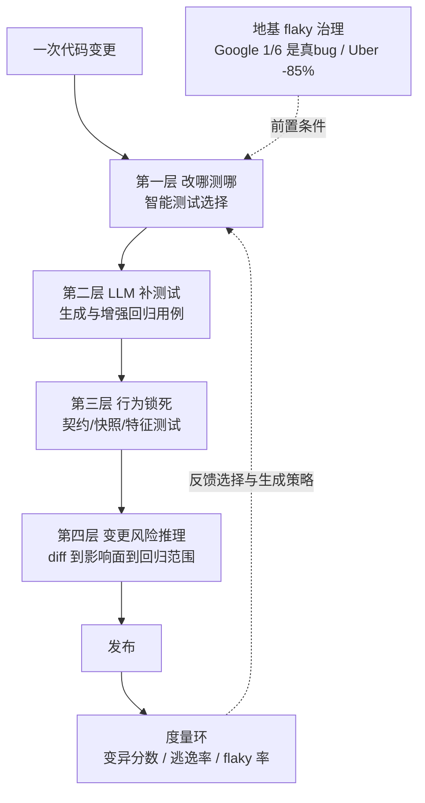

# 02 · 回归保护：如何保证新功能不影响旧功能、回归测试执行有效

> 本篇回答两个问题：①新功能上线时，旧功能怎么保证不被破坏；②回归测试怎么"执行得有效"（不是跑得多，而是跑得准、抓得住问题、测得动）。核心框架是**四层防线 + 一个度量环 + 一条地基（flaky 治理）**，每一层都有大厂/国内团队的一手量化证据。
>
> 条款编号前缀【S2.#】。踩坑细节见 07 篇 S7.3；"每次改动测到前后端"的联动执行见 03 篇。

---

## S2.1 总体框架：四层防线 + 一个度量环

各层回答的问题：第一层"该跑哪些旧测试"；第二层"旧测试不够怎么办"；第三层"旧功能的行为用什么锁住"；第四层"这次改动风险多大、要不要升级回归策略"。**顺序不能反：flaky 不治，上面四层全是空转**（S2.6）。

---

## S2.2 第一层：智能测试选择（Predictive Test Selection）

**S2.2.1 Meta 开山之作：ML 预测选测试，成本减半、故障捕获率不掉。** 用历史"变更-测试结果"数据训练模型为每次变更选测试子集，生产环境部署后**测试基础设施成本减半**，同时保证 >95% 单个测试失败、**>99.9% 的故障变更仍被上报**；模型显式建模了 flaky（https://arxiv.org/abs/1810.05286 ，【已验证】）。注意：engineering.fb.com 上的同名博客已 404，引用以论文为准。

**S2.2.2 国内同范式落地（覆盖率插桩 + 用例映射）：**
- **字节 Bytest（智能精准测试）**：飞书多维表格 Web 业务 1.5 万+ 回归用例、单次回归 20+ 人日 → istanbuljs 编译期插桩采函数级覆盖率 + Chrome 插件录制建立"用例↔函数双向关联" + 语义化 Diff 提取变动函数 + 打分排序。结果：**推荐冗余降低 54%、测试成本降低 44.9%**，线上问题召回率与全量回归打平（试验版本 36 个缺陷，零逃逸）；录制成本损耗从 9.08% 优化到 3~4%（https://juejin.cn/post/7376231612440887335 ，【已验证】）。
- **美团"后羿"（变更风险可视化）**：AST→ASM 字节码分析（解决 Lambda/泛型识别）+ 调用链入图数据库 + Mtrace 线上链路补充跨服务关系；1-2 分钟出分析报告，HTTP/RPC 接口识别率 98%+，用于接口级用例推荐、配置变更卡点、兼容性预警（反射/序列化分析间接 VO 变化）（https://tech.meituan.com/2023/09/22/Construction-and-practice-of-code-change-risk-visualization-system.html ，【已验证】）。
- **闲鱼（阿里）**：Gitlab diff → 变更方法 → 流量录制平台建立的"方法↔入口接口映射" → 提测自动召回流量用例回归；链路采集对 RT 影响大，只敢在预发挂载；全量回归从每周 MNn7 降到 KNn7、单次一般小于 1 分钟（https://juejin.cn/post/7033600207317106718 ，【已验证】）。
- **得物商家域精准测试**：AST 调用链 + Trace2.0 + Diff → 接口级用例推荐，平均精准率约 80%（迭代间波动 63%~100%），提效 0.5-1h/人/迭代（https://juejin.cn/post/7314365540551131187 ，【已验证】）。
- 更多国内样本（爱奇艺/转转/货拉拉/京东/vivo MoonBox）见 research/B 底稿 §4.6 与 S2.8。

**S2.2.3 商业化与风险分变体。** Launchable（Jenkins 作者创办）按 confidence 百分比选择子集（https://help.launchableinc.com/features/predictive-test-selection/ ，【已验证】）；Meta Diff Risk Score 用微调 Llama 对变更打风险分驱动测试选择与发布（19 个用例，DRS"eliminate major code freezes"）（https://engineering.fb.com/2025/08/06/developer-tools/diff-risk-score-drs-ai-risk-aware-software-development-meta/ ，【已验证】）。

**S2.2.4 学术边界（重要）：LLM 不适合独立承担影响面计算。** GPT-5 预测受影响代码实体"表现不佳"（https://arxiv.org/abs/2512.19481 ，【已验证-arXiv API】）；工业落地系统（Meta DRS、美团后羿、字节 Bytest）无一例外是**静态分析/调用链/覆盖率/流量数据打底 + 规则打分 + LLM 做风险解释与特征增强**。需求层变更影响分析可用 RAG 增强到 recall 95.8%（https://arxiv.org/abs/2511.00262 ，【已验证-arXiv API】）。

---

## S2.3 第二层：LLM 生成/增强回归测试

**S2.3.1 标杆：Meta TestGen-LLM 的"可度量改进过滤器"。** 定位是改进人写的存量测试而非从零生成；每条建议必须连续通过过滤器——**75% 构建成功 → 57% 稳定通过 → 25% 提升覆盖率**，最终 **73% 建议被工程师接受合入生产**（Instagram Reels/Stories 的 test-a-thon）。作者称之为首个带"代码改进保证"的工业规模 LLM 代码部署；方法论要点：**用确定性过滤器从机制上消除幻觉影响，而不是靠提示词**（https://arxiv.org/abs/2402.09171 ，【已验证】）。

**S2.3.2 商业化标杆：Diffblue 用变异分数自证。** 官方基准（8 个企业 Java 仓库、3.1 万行可覆盖代码）：Diffblue Testing Agent + Claude Code vs Claude Code + 高级工程师——行覆盖 **80.7% vs 32.3%**，**变异分数 61.3% vs 24.2%**，测试强度 81.8% vs 73.9%，人工介入 "Setup only" vs 8.5 小时；所有生成的测试交付前验证可编译可通过，按"验证过的行覆盖"计费（https://www.diffblue.com/ ，【已验证】）。**关键启示：只报行覆盖率会高估 AI 测试的捕获力，变异分数才是验钞机（S2.7）。**

**S2.3.3 国内一手复盘：美团三种人机协作策略。** ①单测检验 AI 代码（AI 生成分页接口代码里 Boolean 字段比较恒 false，AI 写的 17 个测试立即失败定位，顺带暴露 N+1 查询）；②"安全网"保护存量代码（改前先跑基线，"预期内的失败"证明改动边界清晰）；③TDD 驱动 AI（优惠券规则引擎纯提示词 3 次失败，改 TDD 后一次通过并完成策略模式重构）。配套 Rule 防止 AI"为通过测试作弊改业务代码"（RED 阶段禁改 src/main/、GREEN 阶段禁改测试）（https://tech.meituan.com/2025/12/05/AI-Coding-Unit-Testing.html ，【已验证】）。

**S2.3.4 Kent Beck 的"缰绳"工作法。** plan.md + TDD 循环驱动 AI：AI 找下一个未标记测试、只写"刚好让它通过"的代码；人决定下一个测什么并核实 AI 真的照做。脱轨信号：AI 自己加循环/未要求的功能/**禁用或删除测试**（https://newsletter.kentbeck.com/p/augmented-coding-beyond-the-vibes ，【已验证】）。

**S2.3.5 学术成色研究（AI 测试没有宣传的那么好）。**
- 21.6 万个类级测试的大规模独立研究：幻觉导致**编译失败率高达 86%**；推理式提示有帮助，可维护性问题依旧（https://arxiv.org/abs/2407.00225 ，【已验证-arXiv API】）。
- VibeCheck（2026-09）：对 Kiro/Antigravity/Cursor 生成测试的五维评分发现 **"execution-adequacy gap"——测试能跑但断言弱、覆盖浅**（https://arxiv.org/abs/2609.05978 ，【已验证-arXiv API】）。
- LLM 测试中 test smell（Assertion Roulette、Magic Number 等）系统性扩散（https://arxiv.org/abs/2410.10628 ，【已验证-arXiv API】）。
- LLM 做测试**维护**（修复/更新）收益"marginal"（TAM-Eval，1539 个场景）（https://arxiv.org/abs/2601.18241 ，【已验证-arXiv API】）。
- few-shot 示例选**人写的**测试效果最好（coverage/correctness 双高）（https://arxiv.org/abs/2602.12256 ，【已验证-arXiv API】）。

---

## S2.4 第三层：行为锁死（旧功能的当前行为 = 显式契约）

**S2.4.1 契约测试 Pact。** 消费者在测试中生成描述期望的 contract，提供者对契约 verify；"提供方未被消费方使用的行为可以随意改而不破坏测试"；Broker 的 can-i-deploy 做发布门禁（https://docs.pact.io/ 、https://pact.io/ ，【已验证】）。AI 增强：PactFlow 2025 年推出 AI 测试模板（按团队风格生成契约测试、扩至 7 种语言）、AI 代码审查契约测试最佳实践、MCP Server 把契约工具带进 IDE 供 agent 调用（https://pactflow.io/blog/ ，【已验证】）。**"改一处测两头"的前后端联动展开见 03 篇 S3.4。**

**S2.4.2 快照 / 金标准测试：好用但极易疲劳。** Kent C. Dodds 总结的坑：失败难诊断、开发者遇到失败的本能是"炸掉快照重录一遍"；640+ 行的大快照"没人评审"；建议用 `no-large-snapshots` 规则限制、自定义 serializer、`snapshot-diff` 只断言差异（https://kentcdodds.com/blog/effective-snapshot-testing ，【已验证】）。AI 时代含义：AI 大量改 UI/输出时快照是最便宜的"行为锁"，但必须小而专、过评审，否则沦为"全员一键 update"的仪式（S7.3）。

**S2.4.3 特征测试（Characterization Tests）+ LLM：最危险也最有价值。** Michael Feathers 经典方法：固定遗留代码"当前实际行为"（哪怕是 bug）作为改造安全网。AI 增强的新风险——**misguidance effect**：被测代码有 bug 时，LLM 会"把错误行为当成预期断言写进测试"而不是暴露 bug；对策是先用 LLM 生成规格 docstring 替换被测代码再生成测试（可减少误导测试、增加找 bug 测试）（https://arxiv.org/abs/2607.22883 ，【已验证-arXiv API】）。**规则：AI 辅助生成的特征测试必须人工过目"这真的是我们想要的现状吗"。**

---

## S2.5 第四层：变更风险推理（风险分决定回归策略强度）

- **Meta DRS**（S2.2.3）：LLM 产出风险分+风险片段，驱动测试选择/评审/发布策略（【已验证】）。
- **美团后羿**（S2.2.2）：风险可视化 + 配置变更卡点 + 兼容性预警（【已验证】）。
- **微软 CodePlan**：仓库级编辑建模为"增量依赖分析 + may-impact 分析 + 自适应规划"，5/6 仓库通过有效性检查而基线全挂（https://arxiv.org/abs/2309.12499 ，【已验证-arXiv API】）。
- LLM 独立做影响面推理不可靠（S2.2.4）；**正确分工是：确定性数据算账，LLM 解释风险**。

---

## S2.6 地基：Flaky 测试治理（回归有效性的头号敌人）

**S2.6.1 Google：1/6 的 flaky 转变是真 bug。** 分析约 420 万个测试：测试越大越 flaky（近似线性）；某团队发现稳定测试因某次变更转 flaky 时，**1/6 是生产代码的真实 bug**——决不能无脑隔离/禁用；方法论四环 identification/notification/triage/prevention；重试机制只给已标记 flaky 的测试用（https://testing.googleblog.com/2017/04/where-do-our-flaky-tests-come-from.html 、https://testing.googleblog.com/2016/05/flaky-tests-at-google-and-how-we.html ，均【已验证-WebReader 实抓】）。

**S2.6.2 Uber：TAS 治理 flaky -85% 之后才敢开自动重试。** 判定标准"主分支 100 连胜才算稳定"；自动复现器（端口冲突检测、CPU 高负载下重跑暴露时序依赖）；根因结论"多数 flaky 源于外部因素"（并行 CI 资源争抢、内嵌中间件启停 bug），对策是迁 testcontainers + Error Prone 静态规则拦截已知 flaky 模式 + Fix It Week 众包修复（原 eng.uber.com 已下线，经 Wayback 实抓：https://web.archive.org/web/2021/https://eng.uber.com/handling-flaky-tests-java/ ，【已验证】）。

**S2.6.3 Azure DevOps 内建 flaky 生命周期。** 系统检测（同一次执行内重跑，"失败后重跑通过即标记 flaky"）→ 分支级共享状态 → 可选不阻塞流水线 → 手工 resolution → 闭环（https://learn.microsoft.com/en-us/azure/devops/pipelines/test/flaky-test-management ，【已验证】）。

**S2.6.4 落地顺序。** 先治 flaky（统计判定 + 根因复现器 + 隔离），再上预测性测试选择与自动重试——否则选择模型的训练数据被 flaky 污染、门禁信号被噪音淹没。

---

## S2.7 度量环：回归测试集有效性怎么量化

**S2.7.1 变异测试（Mutation Testing）是验钞机。** Google 在代码评审中只对变更代码做变异，2.4 万开发者规模落地（https://arxiv.org/abs/2102.11378 ，【已验证-arXiv API】）；Diffblue 把变异分数当核心卖点（S2.3.2）。AI×变异四条前沿路线（均 arXiv API 验证）：①变异分数当 AI 测试验收指标；②Critic 循环——变异测试点名存活缺陷、Critic 补测试杀变异体（平均增量杀死率 0.783，https://arxiv.org/abs/2607.23002 ）；③LLM 造"意图级变异"（55% 是传统语法变异覆盖不到的真实故障模式，https://arxiv.org/abs/2607.05149 ）；④LLM 解等价变异体判定（https://arxiv.org/abs/2607.00511 ）。

**S2.7.2 指标体系（从各来源归纳）：**
- **门禁层**：通过率、flaky 率（重跑不一致率）、阻断失败中真实 bug 占比（用 Google"1/6"校准）。
- **选择层**：推荐收益（省掉的用例/工时）、**逃逸率红线**（字节：P0/P1 线上逃逸不得增加）、精准率（得物 a/(b+c) 口径）与召回率（字节：线上问题召回与全量打平）。
- **质量层**：行覆盖率必须搭配**变异分数/测试强度**才有意义；AI 生成测试用 TestGen-LLM 漏斗（build→稳定→覆盖提升→人工采纳）验收。

---

## S2.8 补充武器：流量录制回放

**S2.8.1 开源工具谱系（均已实抓验证）：**
- GoReplay：HTTP 流量录制回放事实标准之一，监听网卡无需改造业务（https://github.com/buger/goreplay ，【已验证】）。
- jvm-sandbox-repeater（阿里开源）：无侵入录制 HTTP/Dubbo 入参返回值，回放时子调用 Mock，官方场景即"业务回归，无需人工编写测试脚本和准备数据"（https://github.com/alibaba/jvm-sandbox-repeater ，【已验证】）。
- MoonBox（vivo 开源）：基于 jvm-sandbox-repeater 重写的录制回放平台，内部运行 2 年+，录外部依赖作回放 mock（https://github.com/vivo/MoonBox ，【已验证】）。
- AREX（携程系开源）：无侵入数据采集 + 自动化 Mock + 快速复现线上 bug（https://github.com/arextest/arex ，【已验证】）。

**S2.8.2 与 AI 的结合点（现状判断）。** 当前公开落地仍是"流量回放平台 + 规则/覆盖率"组合；AI 的现实角色在**结果比对降噪**（返回值 diff 智能归并）、**失败分诊**（回放失败聚类归因到变更）与 DRS 式风险调度。尚未见到"LLM 端到端决定回放范围"的成熟公开案例。

**S2.8.3 常见坑。** 时间戳/自增 ID 等动态字段噪声、下游版本漂移导致误报、链路采集影响生产 RT（闲鱼只敢在预发挂载；字节录制成本损耗 9.08%→3~4%）。对策：采样防护、脱敏归一化、回放失败聚类分诊（多篇国内实践交叉，底稿见 research/B §7）。

---

## S2.9 兜底与红线（可直接抄进团队规范）

1. **永远保留周期性全量回归兜底**——预测性选择保的是 99.9%（Meta 口径）而非零漏测；字节的红线是"最小用例集必须发现版本回归全部缺陷、P0/P1 线上逃逸率不得增加"，并用数学验证（高维函数空间 Wasserstein 距离）证明阈值过滤不降低召回。
2. **测试文件进只读保护/评审强门禁**——AI 作弊的头号信号是禁用/删除测试（Kent Beck）或改业务代码凑绿（美团 Rule）。
3. **AI 生成的测试先过硬过滤器再进回归集**（build→稳定→覆盖提升），并抽验"断言是不是在复读实现"（tautological tests，S7.3）。
4. **特征测试/快照必须人工评审"现状≠预期"**——misguidance effect 会把 bug 锁成标准。
5. **测试集与代码同步演进**，否则"价值迅速归零，甚至成为负资产"（美团）；LLM 做测试维护收益 marginal（TAM-Eval），维护闭环不能全托给 AI。
6. **精准率按迭代公示**——得物精准率在 63%~100% 间波动，特例要回灌策略。
