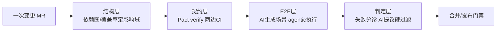

# 03 · 前后端联动：如何保证每改动一处，前端、后端都被测到

> 本篇回答："改一个接口/组件，怎么确保相关的前端页面和后端服务都被测到，而不是各测各的"。答案不是"跑更多 E2E"，而是一套**分层门禁**：结构层定范围 → 契约层锁接口 → E2E 层验旅程 → 判定层做分诊。每层都有已验证的一手证据。
>
> 条款编号前缀【S3.#】。回归保护的四层防线见 02 篇；AI 判定的方法论见 04 篇。

---

## S3.1 问题定义与总原则

前后端"各测各的"的经典漏洞：前端改了字段名、后端没改（或反之），单测全绿、联调爆炸。结构性解法是把"前端期望 ↔ 后端实现"的兼容性变成**可以被两边 CI 各自把关的工件**（契约），把"这次改动必须跑哪些测试"变成**可计算的映射**（依赖图/覆盖率插桩），AI 在这两层之上做增强（生成场景、执行探索、判定结果）。

---

## S3.2 结构层：改动 → 必须跑的测试集（映射机制）

**S3.2.1 字节 SmartEye：国内最完整的"改动→用例"映射落地。** 建立在覆盖率监测平台之上的精准测试中台，三步机制：①用例知识库（人工用例 UI 录制 + 自动化用例批量录制，建"调用信息-CaseIDs 倒排索引"）；②CodeGraph 双端静态调用链分析，定位 MR 的代码变动及上下游影响域；③召回 + 多样性削减 + ML 排序。效果：每日推荐用例 1K+，某业务线**在保证"全量测试能发现的问题 100% 不漏"的基础上人效提升约 40%**——这是联动测试通过标准的标杆口径（https://developer.volcengine.com/articles/7599493947916582938 ，【已验证】）。

**S3.2.2 Nx affected：monorepo 的轻量版结构映射。** `nx affected -t test` 基于 git diff + 项目依赖图"确定受变更影响的最小项目集合"，只跑受影响项目的构建/测试；关键实践：base SHA 要设为"main 上最近一次成功 CI 的 commit"（配 nrwl/nx-set-shas），保证自上次成功运行以来的所有改动都被覆盖（https://nx.dev/ci/features/affected ，【已验证】）。前端仓库里"改共享库 → 组件测试 + 上游 app 的 E2E 冒烟自动入列"用 Nx/Bazel/Turborepo 依赖图即可实现。

**S3.2.3 预测式选择谱系。** Launchable（ML+历史结果）、Meta 预测测试选择（S2.2.1）、字节 Bytest/SmartEye（覆盖率插桩）同属一个谱系：**运行时覆盖率映射**与**静态依赖图**两类做法，前者召回好、后者可解释；生产级系统通常双轨。

---

## S3.3 契约层：改一处测两头的结构性保证

**S3.3.1 Pact 的机制与回归语义。** 消费者（前端/BFF）在测试中生成描述期望的 contract，提供者（后端）对契约 verify——前端改了期望 → 契约变 → 后端 CI verify 失败即刻发现破坏性变更（Atlassian 团队："they received immediate feedback in their tests when a breaking change was about to be made to the API implementation"）；Broker + can-i-deploy 判断组件能否安全发布。官方主张可以因此移除复杂脆弱的端到端集成环境——ITV"消除了紧耦合集成测试环境"，Mastercard 在 100+ 微服务间用 CDC 测服务交互（https://pact.io/ 、https://docs.pact.io/ ，【已验证】）。

**S3.3.2 AI 增强（PactFlow，2025）。** AI 测试模板按团队风格/框架/SDK 版本生成契约测试（扩至 Kotlin/.NET/Go/PHP/Swift 等 7 种语言）；AI 代码审查契约测试最佳实践；PactFlow MCP Server 把契约工具带进 IDE 供 agent 调用（https://pactflow.io/blog/ ，【已验证】）。

**S3.3.3 为什么 AI 时代契约测试价值反而上升。** E2E agent 跑得再好也覆盖不了全部前后端组合；契约在两边 CI 各自把关，是"改一处测两头"**最便宜的结构性保证**。AI 生成的 API 断言（如 Postbot）再与契约对齐，防止两边各说各话。

---

## S3.4 E2E 层：AI 驱动的端到端联动验证

**S3.4.1 Playwright MCP：agentic E2E 的底座。** 微软官方让 LLM 通过**结构化 accessibility snapshot**（而非像素截图）操作网页——更确定、省 token；`--caps=testing` 提供断言与定位器生成工具；`--codegen` 可把 agent 的一次操作会话沉淀成 typescript/python 等测试代码——"agent 探索一次，沉淀成回归测试"。README 同时明确取舍：CLI+skills 对编码 agent 更省 token，MCP 适合探索式自动化/自愈/长时工作流；并自述 "Playwright MCP is not a security boundary"（`browser_run_code_unsafe` 是 RCE 级能力），CI 里跑要隔离环境（https://github.com/microsoft/playwright-mcp ，【已验证】）。GitHub 官方亦有 Copilot + Playwright MCP 端到端调试 web 应用的演示（https://github.blog ，【未验证-仅搜索可见】）。

**S3.4.2 Playwright Test Agents：需求→计划→测试→自愈的产品化。** Planner 接受自然语言任务（可选 PRD 和种子测试）产出人类可读的 Markdown 测试计划；Generator 把计划转成可执行测试（边执行边验证选择器与断言）；Healer 失败时重放、找等价元素、给补丁——**功能真坏了会跳过而非硬凑通过**（对"AI 改测试凑绿"的制度性防御）。规划产物（specs/）与生成物（tests/）分离、可审计（https://playwright.dev/docs/test-agents ，【已验证】）。

**S3.4.3 商业平台 AI 化（前端+API 两端）。**
- Mabl：自愈（Test Recovery 运行中处理 UI 变化/环境噪音）、"From requirement to runnable test"（粘贴 Jira ticket 自动 author 测试）、失败自动分诊（"Flakiness reports that separate real failures from environmental noise"）、每个 PR 触发 E2E 冒烟并把结果写回 PR（https://www.mabl.com/platform ，【已验证】）。
- Applitools：断言基础从 DOM 定位器改为**视觉元素**，UI 重构测试不必改；相似视觉差异自动分组、接受一个 diff 批量应用到所有匹配测试；一条断言覆盖 functional/visual/API/accessibility（https://applitools.com/platform/ ，【已验证】）。
- Postman Postbot（后端侧）：为请求生成测试脚本与断言、修复已有测试、提取字段（https://learning.postman.com/v11/docs/getting-started/basics/about-postbot ，【已验证】）。
- 自愈定位器谱系：Healenium（开源自愈基线，DOM 树编辑距离）、Testim/Functionize（ML 多属性定位器）。**警告见 S7.3：自愈率过高是坏味道**（sdet.qa："a very high heal rate can be a smell"，【⚠️抓不到-搜索摘要可用】）。

**S3.4.4 Agentic QA（AI 当 QA 工程师全流程跑）。**
- QA Wolf："人 + AI agent"的 fully managed 模式，承诺数周内 80%+ 自动化 E2E 覆盖、测试挂了 24 小时内修复；竞品批评其"100% coverage"是虚荣指标——覆盖率类宣传需打折（https://www.qawolf.com/service/qa-automation-services ，【未验证-仅搜索可见】）。
- AUITestAgent（复旦+美团，注意不是字节）：自然语言测试需求 → 多 agent 完成指令提取规划→交互执行→数据提取与校验全链路；校验层就是"AI 判断业务逻辑"在 UI 层的落地（跨页面数据一致性、发布后必须出现在主页等不变量），异常检测召回 90%、误报仅 4.5%（https://github.com/bz-lab/AUITestAgent/blob/main/README_zh.md ，【已验证】；论文 arXiv:2407.09018）。
- 字节 UI-TARS：原生 GUI agent 模型（感知/推理/记忆/行动一体化，强化学习实现"行动前先思考"），7 项 GUI 基准 SOTA；代表 UI 自动化从"定位器脚本"转向"视觉 grounding + 推理"的模型化路线（https://seed.bytedance.com/zh/blog/bytedance-seed-agent-model-ui-tars-1-5-open-source-achieving-sota-performance-in-various-benchmarks ，【已验证】）。

---

## S3.5 判定层：通过标准与失败分诊

**S3.5.1 通过标准（推荐口径，来自已验证案例）：**
1. 结构层映射 completeness：受影响项目/用例 100% 入列（Nx affected 的 base-SHA 实践；SmartEye 以"全量测试能发现的问题 100% 不漏"为下界）。
2. 契约 verify 全绿：消费者/提供者两侧 CI 均通过；can-i-deploy 门禁通过。
3. E2E 冒烟：用户旅程级场景通过，且结果带 network/console/视觉证据（agentic 执行的天然优势）。
4. 失败分诊完成：每次失败归类为"真实回归 / 环境噪音 / 应用变更"，不允许未分诊的失败反复重跑撞绿灯。
5. flaky 率与自愈率有上限监控（S7.3）。

**S3.5.2 失败自动分诊的证据。** Mabl 把"每次失败都被自动调查"做成产品能力、用 flakiness reports 区分真实失败与环境噪音（【已验证】）；Google 用 LLM 诊断集成测试失败准确率 90.14%、服务 5.2 万+失败测试（arXiv:2604.12108，【已验证】）；Uber HackDayz 原型做 CI 失败分类（用户错误 vs 基础设施错误）（【已验证】）。

---

## S3.6 本篇工程综合（可直接落地的四层配置）

1. **结构层**：Nx/Bazel 依赖图（或 SmartEye 式覆盖+调用链精准测试）决定"这次改动必须跑哪些前端组件测试与后端 API 测试"。
2. **契约层**：Pact 契约在消费者/提供者两侧 CI 各自 verify；broker 的 can-i-deploy 做发布门禁。
3. **E2E 层**：需求/工单 → AI 生成用户旅程场景（Gherkin 或自然语言，见 05 篇）→ agentic E2E（Playwright MCP / Playwright Test Agents / Mabl / AUITestAgent 类）在真实前后端环境跑冒烟，通过的路径固化为代码化用例进 CI。
4. **判定层**：失败自动分诊 + AI 提议硬过滤器（TestGen-LLM 式 build/reliability/coverage 过滤、契约 verify）兜底，最终批准留给人类（04 篇）。
