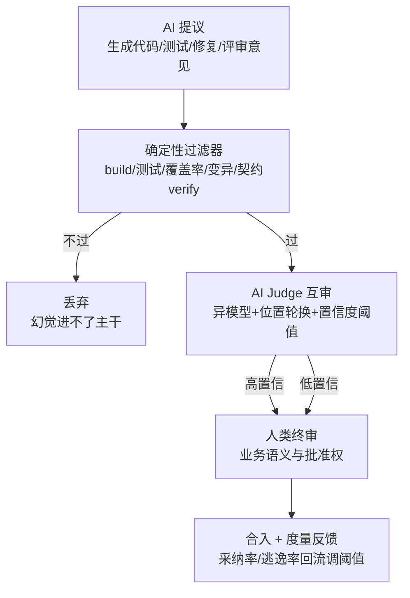

# 04 · 让 AI 像人一样判断逻辑是否正常：LLM-as-judge、AI 代码评审与业务正确性

> 本篇回答："如何让 AI 判断逻辑是否正常"——包括判断 AI 生成的代码/测试对不对、判断一次变更有没有破坏业务规则、判断测试结果是否可信。核心结论：**方法论基线是 MT-Bench 证明的">80% 人类一致率 + 三类系统性偏差"；生产范式是"AI 提议 + 确定性过滤器 + 人类终审"**——单独信任任何一段都不成立。
>
> 条款编号前缀【S4.#】。

---

## S4.1 方法论基线：LLM-as-judge 能干什么、会错在哪

**S4.1.1 可行性：GPT-4 judge 与人类偏好一致率 >80%，达到人与人之间一致的水平。** MT-Bench/Chatbot Arena 论文（NeurIPS 2023）确立 LLM-as-a-judge 为"可扩展、可解释地逼近人类偏好"的方法，80 题多轮基准与 3 万带偏好对话开源（https://arxiv.org/abs/2306.05685 ，【已验证】）。

**S4.1.2 三类系统性偏差（迁移到工程判定场景同样存在）：**
- **位置偏差**：先出现者占优，交换顺序会翻案（交换位置后仅 65% 一致）——评审 PR 时"先看到的 diff 更容易被放过或被打"。
- **冗长偏差**：偏爱更长的回答——"报告越长越像好报告"。
- **自偏好（self-enhancement）**：偏爱自己生成的答案——**让编码 agent 自查自己写的代码会手软**。
- 缓解手段：成对比较 + 位置轮换取一致票、judge 与被评对象异模型/异会话、rubric 拆分细化评分项。

**S4.1.3 可靠性综述的定位。** judge 优势在 scalable/cost-effective/consistent，核心难题是可靠性（一致性不足、偏差、难适配多样场景），生产使用必须配"评估 judge 本身"的环节（抽样人审对齐）（https://arxiv.org/abs/2411.15594 ，【已验证】）。

**S4.1.4 工程附加坑：判定结果的版本敏感与不稳定。** prompt、模型版本、rubric 任一变化都可能让缓存的历史判定失效——缓存键要把 (prompt 版本, 模型版本, 输入 hash) 一起编进去；同一输入多次判定可能翻转，重复判定方差要测量（综合工程实践，底稿见 research/C 踩坑 #6）。

---

## S4.2 大厂范式：AI 提议 + 确定性过滤器 + 人类终审

这是"AI 判断"在工业界最可靠的三段式。两个标杆：

**S4.2.1 Meta TestGen-LLM：过滤器兜住幻觉。** LLM 只负责提议测试改进，每条建议必须通过确定性过滤器（构建通过 → 稳定通过 → 覆盖率提升），最终 73% 被工程师接受合入生产（https://arxiv.org/abs/2402.09171 ，【已验证】）。启示：**AI 的"判断"输出永远要有一个不依赖 AI 的验证机制兜底**——编译器、测试、变异分数、契约 verify 都是现成的过滤器。

**S4.2.2 SWE-bench Verified：LLM 初筛 + 人类终审剔除 70% 坏样本。** 2024-08 与 OpenAI 合作：由真实工程师确认 500 个问题"solvable"，过滤原数据集中任务歧义、测试用例有误/悬空引用、实际不可解的问题（1694 → 500）（https://github.com/princeton-nlp/SWE-bench 、https://www.swebench.com/ ，【已验证】；OpenAI 公告【⚠️抓不到-搜索摘要可用】）。启示：**AI 生成的测试用例/任务先过正确性判定，再进回归集。**

**S4.2.3 Google Auto-Diagnose：AI 判定要挤进开发者心智很难。** LLM 自动诊断集成测试失败，71 个真实故障人工评估准确率 90.14%、全公司部署、服务 5.2 万+失败测试；但即便 90%+ 准确率，在 Critique 的 370 个工具帮助度排名中只列第 14、仅 5.8% 用户认为 Not helpful——准确率≠被采用，判定工具要嵌入既有工作流而非新开窗口（https://arxiv.org/abs/2604.12108 ，【已验证】）。

**S4.2.4 美团的 Judge 互审。** 高配模型当 Judge 审低阶模型的输出、不同厂商模型对抗互审，作为 Pre-PR 自查的一环（https://tech.meituan.com/2026/05/07/Agent-AI-Coding.html ，【已验证】）——"异模型评审"是 S4.1.2 自偏好偏差的工业级对策。

---

## S4.3 AI 代码评审：产品图谱与真实信噪比

**S4.3.1 产品格局（均已实抓验证）：**
- **GitHub Copilot code review**：网页端 Request Copilot 或 `gh pr edit N --add-reviewer @copilot`；两档力度（Lite 查 bug/安全/风格；Balanced 覆盖复杂逻辑、安全敏感代码与**跨服务变更**）；官方承认限制——评论不计入 required approvals、重审会重复已 dismiss 的评论（https://docs.github.com/en/copilot/using-github-copilot/code-review/using-copilot-code-review ，【已验证】）。
- **CodeRabbit**：可提交建议（Committable suggestions）、持续学习团队约定、Codegraph 确定性影响节点映射、Quiet/Chill/Assertive 三档风格、与编码 agent 循环协作（review 发现问题→agent 修→复验）；厂商数据（Writer 建议接受率 70% 等）需打折（https://www.coderabbit.ai/ ，【已验证】）。
- **Greptile**：先建仓库图再让 agent 集群评审 diff 之外的影响，能发现多文件逻辑 bug；Brex CTO 称其"唯一不烦人的 AI 评审工具"；TREX agent 在沙箱里为每个 PR 写并跑测试抓边界情况（https://www.greptile.com/ ，【已验证】）。
- **Qodo**：从代码库、PR 历史和需求构建组织级 "Review Standards"，评审 agent 先应用团队规则、无命中才回退通用最佳实践；Rule Miner 把团队历史评审意见自动沉淀为机器执行规则；多 agent 并行评审后由 judge agent 合并去重、过滤低置信发现（https://docs.qodo.ai/code-review ，【已验证】）。
- **Graphite Diamond**：主打高信号低噪音；官方博客公开论述"AI 评审边界"（见 S4.3.2）（https://graphite.com/blog ，【已验证-博客索引】）。

**S4.3.2 Graphite 的一手复盘：AI 评审最大坑是信噪比。** 早期实验幻觉严重——"基于误读代码行或缺失上下文而对 diff 错误评论"，误报:真报约 9:1；三轮改进（评审指南、RAG 上下文、**让模型敢沉默**——"像积极的学生，GPT-4 讨厌保持沉默"）后降到 1:1，作者仍判"signal to noise ratio was just not good enough"；结论：AI 做 "super-linter"，**最终批准"indefinite future"留给人类**——因为评审远不止看代码（渐进式改进愿景、对作者的信任、知识共享、问责、风险判断"表有千条还是十亿条记录？"）（Graphite 博客 problems-with-ai-review，【已验证】）。

**S4.3.3 分工结论。** AI 评审接管低级信号（lint/风格/明显 bug/团队规则符合性），人保留架构与业务判断；不要把 required approval 交给 AI（Copilot 默认设计即是如此）。Google 的经典分工论述（低级评审信号自动化 + 人聚焦设计问题）见《Modern Code Review: A Case Study at Google》（https://research.google/pubs/modern-code-review-a-case-study-at-google ，【未验证-仅搜索可见】）；Google 已验证的 LLM 公开工作是 Code Understanding（ICSE 2024，arXiv:2307.08177）——**注意：流传的"Google 用 LLM 做代码评审"论文经实抓无法证实，勿引**（research/C 已纠偏）。

---

## S4.4 业务规则/不变量审查：让 AI 对照"业务常识"判断

这是"像人一样判断逻辑正常"的关键一步——不止语法/单测正确，还要符合业务规则（幂等、权限、库存不为负、风控阈值）。

**S4.4.1 当前最可行的三条产品化路径（均已验证）：**
1. **把业务不变量写成自然语言规则文件，让评审器逐 PR 检查**：Qodo "Steer a review with your own guidelines"（如"支付改动必须带幂等键""不得绕过租户校验"写成 Review Standards）（https://docs.qodo.ai/code-review ）；Greptile "Write standards in plain English"（https://www.greptile.com/ ）；Copilot 支持 `.github/copilot-instructions.md` + 路径级 instructions（https://docs.github.com/en/copilot/using-github-copilot/code-review/using-copilot-code-review ，均【已验证】）。
2. **把不变量写成测试断言，由确定性机制硬验证**：Kiro 的 property-based tests "assert rules that must hold across all inputs"（https://kiro.dev/ ，【已验证】）。
3. **UI 层不变量的 agent 校验**：AUITestAgent 从自然语言需求提取业务校验（跨页面评分一致性、发布后必须出现在主页、点赞必须变蓝），异常检测召回 90%、误报 4.5%（https://github.com/bz-lab/AUITestAgent/blob/main/README_zh.md ，【已验证】）。

**S4.4.2 需求→代码的静态验证闭环（学术-工业过渡形态）。** 两阶段工作流：先从自然语言需求提取"可验证规则"并同时**显式标记歧义与自相矛盾**，再用规则审计代码（https://arxiv.org/abs/2605.17926 ，【已验证-arXiv API】）。

**S4.4.3 诚实的边界声明。** "金融/电商团队用 LLM 对 diff 提问'这会不会破坏 XX 规则'"的**一手复盘公开案例仍缺位**（检索未见可验证文章，research/C 已如实标注）；现状是把业务不变量写成规则/断言交给评审器与测试，人类终审保批准权。

---

## S4.5 判定的工程护栏清单（可抄）

1. **异模型/异会话评审**，杜绝自偏好；高配模型 judge 低配模型输出（美团）。
2. **位置轮换 + 成对比较**，只采一致票（MT-Bench）。
3. **rubric 拆分**（正确性/安全/风格/性能分开打分），抑制冗长偏差。
4. **置信度阈值 + 低置信静默**——"让模型敢沉默"是降噪关键（Graphite 9:1→1:1 的教训）。
5. **每类问题可静音 + 评论分严重级别**；把**采纳率**（而非评论数）当北极星指标。
6. **AI 判断永远配确定性过滤器兜底**（build/测试/变异/契约）。
7. **判定缓存键含 (prompt 版本, 模型版本, 输入 hash)**；测量重复判定方差。
8. **批准权在人**：AI 是 pre-review/门禁，required approval 保留给人类（Copilot/Graphite 共识）。
