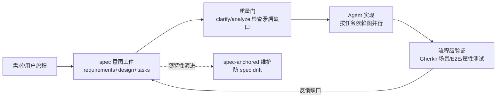

# 05 · 业务流程级：让 AI 跳出单个功能点、深入业务流程

> 本篇回答："如何让 AI 不仅关注某个具体功能点，更深入到业务流程中去"。核心思路：**业务流程要先变成 AI 可锚定的工件（spec / Gherkin 场景 / 测试计划 / 流程模型），AI 才能从"实现某个函数"升级为"理解并守护一条业务旅程"**。本篇覆盖四类工件化路线：Spec-Driven Development、BDD 复兴、流程级测试编排、流程挖掘×LLM。
>
> 条款编号前缀【S5.#】。需求识别专题见 06 篇；SDD 的踩坑见 07 篇 S7.5。

---

## S5.1 为什么功能点级不够

功能点级 AI 协作的典型失败：AI 精确实现了"优惠券满 100 减 20"，但不知道这张券与新人券互斥、不知道退款时券要回补、不知道风控会拦截同一设备批量领券——这些都在**流程与规则层**，不在函数签名里。GitHub 官方对 spec-kit 动机的表述一针见血：模型 "exceptional at pattern completion, but not at mind reading"——模糊 prompt 逼 AI 猜未言明的需求，错误假设在实现后期才暴露（https://github.blog/ai-and-ml/generative-ai/spec-driven-development-with-ai-get-started-with-a-new-open-source-toolkit/ ，【已验证】）。学术佐证：歧义需求一致地降低 LLM 代码生成质量（Orchid 基准，1304 任务，https://arxiv.org/abs/2604.21505 ，【已验证-arXiv API】）。

---

## S5.2 路线一：Spec-Driven Development（规格驱动开发）

**S5.2.1 GitHub Spec Kit：四阶段工作流。** `/specify`（用户旅程+成功标准→详细 spec）→ `/plan`（技术方案）→ `/tasks`（拆成小而可测的任务）→ `/implement`（逐任务执行），每阶段有"批评-修正"检查点；仓库另有 constitution → specify → plan → tasks → implement → converge 循环、clarify/analyze/checklist 质量门、bug 修复流程与"想法评估"流程。官方定位：**最强用例是存量系统的功能开发（N-to-N+1）与遗留现代化**——"capture business logic without carrying technical debt forward"（https://github.blog/ai-and-ml/generative-ai/spec-driven-development-with-ai-get-started-with-a-new-open-source-toolkit/ 、https://github.com/github/spec-kit ，均【已验证】）。

**S5.2.2 Amazon Kiro：把 spec 做成 IDE 一等公民。** 写码前生成 requirements/design/tasks 三件套（requirements.md 用结构化 notation 写用户故事+验收标准；design.md 含架构/时序图/错误处理/测试策略；tasks.md 离散可跟踪），普通流程带**审批门**；"Analyze Requirements"在设计前"catch inconsistencies, ambiguities, and gaps"；用 property-based tests 做规格级验证；执行期按任务依赖图并行（https://kiro.dev/ 、https://kiro.dev/docs/specs/ ，均【已验证】）。

**S5.2.3 Thoughtworks 官方评级：Assess（跟踪评估，未到 Trial）。** Radar 同时点名 Kiro、spec-kit、Tessl Framework 三个工具；担忧原文要点：工作流 "elaborate and opinionated"、行为随任务规模/类型波动、**生成的 spec 难以 review**、PRD/用户故事有时 "lack a clear intended user"——质疑我们是否在重学 "handcrafted rules for AI don't scale" 的教训（https://www.thoughtworks.com/radar/techniques/spec-driven-development ，【已验证】）。

**S5.2.4 Böckeler 三层次框架（理解 SDD 的必读分析）。** Thoughtworks Distinguished Engineer 把 SDD 分三档：**spec-first**（先写规格再用，现有工具几乎全在此档）、**spec-anchored**（规格随特性长期演进维护）、**spec-as-source**（人只改规格不改代码）；实测坑：Kiro 把一个小 bug 变成"4 个用户故事 + 16 条验收标准"，spec-kit 对 3-5 点的故事纯属过度工程，大量重复 markdown 带来评审负担（"I'd rather review code"），agent 会无视指令或机械过度服从——checklist 和 constitution 给人 "false sense of control"；警告类比 Model-Driven Development 在业务应用上的失败：spec-as-source 有把 MDD 的僵硬与 LLM 的非确定性结合的风险（https://martinfowler.com/articles/exploring-gen-ai/sdd-3-tools.html ，【已验证】）。

**S5.2.5 棕地（存量系统）的 SDD 变体：delta spec。** AugmentCode 指南指出 SDD 全流程在存量系统上的五条失效原因（十万级文件超出评审容量、部落知识丢失、未文档化依赖、**隐式行为契约**只能从生产行为逆向工程、不健康代码上 LLM 缺陷风险高 30%）；替代实践：**只 spec 本次修改**（现状行为/目标行为/不变量/范围边界的 delta spec，覆盖率随活跃开发区自然增长）、先做语义依赖地图再规格化（架构师校验）、双路验证（对 spec 和既有测试都校验 + 机器可查契约如 OpenAPI 进 CI）；警告 **spec drift**——规格与行为的差距会复利累积，最终以"非确定性的 AI 失败"形式回归（https://www.augmentcode.com/guides/spec-driven-development-brownfield-codebases ，【已验证】）。

---

## S5.3 路线二：BDD 复兴——AI 解除"写场景成本高"的历史死穴

**S5.3.1 AutoUAT：首个进入企业工作流的量化数据。** 两步流水线：用户故事 →（GPT-4 Turbo）→ Gherkin 验收场景 →（结合被测页面 HTML）→ Cypress 可执行脚本；**生成的场景 95% 被判定"有帮助"，测试用例 60% 直接可用、8% 需小改、24% 需重新生成、8% 丢弃**；已集成进合作企业真实工作流（IEEE/ACM AST 2025，https://arxiv.org/abs/2504.07244 ，【已验证-arXiv API】）。附录发现：开源 70B 模型在基准上接近 GPT 系列——企业私有化可行。

**S5.3.2 Automation Panda：AI 写 Gherkin 质量差是"缺上下文"问题。** 四种典型失败模式：模糊的 Then 步骤、UI 脚本化（写实现细节而非行为）、一个场景塞多个行为、占位符式例子；解法是给 AI 一份规则——开源《Gherkin Guidelines for AI》（Markdown，可接入 Cursor/Claude/Copilot 项目上下文），并呼应 SDD："Good specs are a team sport"（https://automationpanda.com/2026/04/27/bdd-gherkin-guidelines-for-ai-coding-and-testing/ 、https://github.com/AutomationPanda/gherkin-guidelines-for-ai ，【已验证】）。

**S5.3.3 工程要点。** 维护受控的步骤词汇表（step vocabulary）作为生成约束；生成的场景必须人审 + 绑定真实 step definitions 才入回归集；幻觉步骤/措辞不一致是已知质量风险（首个人类被试 quasi-experiment 证实质量需人审，research/D 已收录）。

---

## S5.4 路线三：流程级测试编排与流程挖掘

**S5.4.1 Playwright Test Agents（S3.4.2 已详）从"流程视角"看同样成立：** Planner 接受自然语言任务（如"为游客结账生成计划"）+ PRD 产出 Markdown 测试计划——这就是"需求→流程级测试计划"的产品化；specs/ 与 tests/ 分离可审计（https://playwright.dev/docs/test-agents ，【已验证】）。Mabl 的"From requirement to runnable test"（Jira ticket 直接 author 测试）是商业对应物（https://www.mabl.com/platform ，【已验证】）。

**S5.4.2 流程挖掘（Process Mining）× LLM：让 AI"读懂"真实业务流程。** ProMoAI（IJCAI 2024，van der Aalst 组）：LLM 从文本描述生成流程模型（BPMN 类），支持"人给反馈→模型迭代优化"交互回路，让不懂建模的人也能产出流程模型（https://arxiv.org/abs/2403.04327 ，【已验证】）；BPM 2024 workshop 系列进一步给出"LLM+流程挖掘"的抽象层与提示词框架。结论性共识：**LLM 适合做流程抽象与问答，精确符合性检查仍需确定性算法——LLM 负责读懂流程，算法负责算账**（BPM 2024 论文，【未验证-仅搜索可见】）。

**S5.4.3 AWS Transform 的"从 COBOL 挖业务规格"链路（与 06 篇交叉）。** 主机 agent 逐条抽取业务规则并保持全程可追溯（full traceability），再经 **MCP 直接灌入 Kiro/Claude/Cursor 等 IDE**——"从遗留代码里挖业务流程规格，再喂给 spec-driven 开发"的完整商用链路；Bridgestone 主机现代化 7 个月完成，客户累计代码分析节省 1,305 开发人年（https://aws.amazon.com/transform/ ，【已验证】）。

---

## S5.5 需求→用例→流程覆盖的映射与度量

- **追溯矩阵的产品化方向**：国内测试管理平台（华为云 CodeArts TestPlan 等）已把"需求-用例双向追溯 + 覆盖率矩阵 + 大模型生成用例"作为标配能力方向（产品页抓取失败，【⚠️抓不到-搜索摘要可用】）；Visual RM 宣称"需求文档编制效率提升 70%、评审效率提升 50%"并服务工行等百家头部客户——**厂商通稿口径，需打折**（【未验证-仅搜索可见】）。
- **可引用的硬数字**（跨来源，均见上文）：AutoUAT 场景 95% 有帮助 / 用例 60% 直接可用；Google 迁移 74% AI 生成/省时 50%；SmartEye "全量可发现问题 100% 不漏 + 人效 +40%"。
- **度量建议**：流程级覆盖不看"用例数"，看**关键旅程清单 × 每条旅程的自动化验证方式**（E2E/契约/属性测试）双列表；旅程清单本身由业务方评审签字——这正是 TW Radar 批评 AI 生成 PRD "lack a clear intended user" 的解药：**"这是为谁解决的问题"必须由人回答**。

---

## S5.6 本篇小结与边界

1. **工件化是让 AI 深入业务流程的前提**：spec、Gherkin、测试计划、流程模型——AI 只能锚定在显式工件上，不能锚定在"大家心里的默契"上。
2. **SDD 适合"意图需要长期守护"的场景**（存量系统功能开发、遗留现代化），不适合小修复；delta spec + 双路验证是棕地变体。
3. **BDD 的性价比因为 AI 生成场景而重新变正**（60% 直接可用的硬数据），前提是步骤词汇表受控 + 人审。
4. **流程发现的正确分工**：LLM 读懂流程（抽象/问答/建模草稿），确定性算法算账（符合性检查/影响面计算）。
5. 避坑总则见 07 篇 S7.5：过度文档化、瀑布复活、spec drift、AI 无视或机械服从指令。
