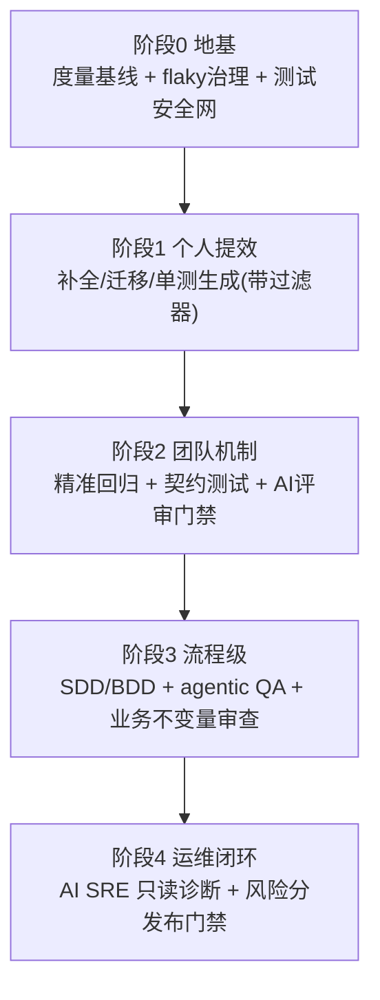

# 08 · 落地路线图：团队如何分阶段把 AI 融入研发全流程

> 本篇把 01~07 篇的证据收敛为一份可执行路线：四个阶段的引入顺序、配套度量体系、组织机制与工具选型速查。原则来自已验证的失败教训：**先地基（度量/flaky/安全网），后智能；先机制（过滤器/门禁），后信任（judge/评审）；机械任务先行，创作任务殿后。**
>
> 条款编号前缀【S8.#】。

---

## S8.1 四阶段引入路线

**S8.1.1 阶段 0：地基（不动 AI，先修系统）。**
- 建度量基线：lead time、变更失败率、MTTR、churn、逃逸率、flaky 率（DORA 2025"放大器"结论要求先有基线，https://dora.dev/research/2025/dora-report/ 【已验证】）。
- 治 flaky：判定标准（Uber"100 连胜"式）+ 隔离带到期复审 + 根因复现器（02 篇 S2.6）。**注意 Google"1/6 是真 bug"红线，不许无脑禁用。**
- 给核心存量模块建测试安全网（特征测试/基线，02 篇 S2.4）。
- 依据：在流程混乱的团队上堆 AI 工具只会更快制造混乱（DORA 2025）。

**S8.1.2 阶段 1：个人提效（ROI 最确定的先上）。**
- 补全类助手（采纳主力是补全而非问答，01 篇 S1.4.1）。
- 机械迁移：测试框架迁移/依赖升级用 sample-tune-sweep 工作流（Airbnb），确定性工具打底（Kotlinator 教训）、长尾人工收尾。
- 单测生成**必须带硬过滤器**（build→稳定→覆盖提升）才能进主干（TestGen-LLM）；few-shot 用人写的例子。
- TDD 缰绳工作法防 AI 作弊（Kent Beck + 美团 Rule）。

**S8.1.3 阶段 2：团队机制（把 AI 嵌进门禁）。**
- 精准回归：覆盖率插桩/调用链 + 用例映射（字节 Bytest/SmartEye、美团后羿模式），红线：逃逸率不得增加 + 周期性全量兜底。
- 契约测试 Pact 双边 verify + can-i-deploy（03 篇 S3.3）——前后端联动最便宜的结构性保证。
- AI 代码评审进 PR 流水线：置信度阈值 + 低置信静默 + 团队规则文件（Qodo Review Standards / copilot-instructions），采纳率当北极星指标（04 篇）。
- 变更风险分（Meta DRS 模式）驱动回归强度与评审人选择。

**S8.1.4 阶段 3：流程级（从功能点到业务旅程）。**
- Spec-driven：按改动规模分档，存量系统用 delta spec + 双路验证（05 篇 S5.2.5）；小修复不上全流水线。
- BDD：AI 从需求生成 Gherkin（受控步骤词汇表 + 人审），60% 直接可用的前提下值得投入（AutoUAT）。
- Agentic QA：Playwright MCP/Test Agents 探索并沉淀回归用例；自愈率设上限监控。
- 业务不变量审查：把幂等/权限/风控规则写成自然语言规则文件 + 属性测试断言，评审器逐 PR 检查（04 篇 S4.4）。

**S8.1.5 阶段 4：运维闭环。**
- 告警降噪先行（无效告警 80%+ 的池子），再上根因定位（RCACopilot 形态：建议而非决策）。
- AI SRE 默认只读 + RBAC + 审批化写操作；生产优先本地模型/脱敏（HolmesGPT/K8sGPT 立场）。
- 发布门禁用风险分（DRS）+ can-i-deploy。

---

## S8.2 度量体系（防"感觉提效"）

**S8.2.1 三层指标：**

| 层 | 指标 | 防的是什么 |
|---|---|---|
| 任务层 | AI 建议采纳率（评审意见/生成测试被接受比例）、补全留存率 | judge 降噪、生成质量 |
| 交付层 | lead time、PR 体积、返工率、churn、变更失败率、缺陷逃逸率 | 任务级提速幻觉（METR/Uplevel） |
| 质量层 | 重复率/重构率（GitClear 指标）、变异分数、flaky 率、测试集腐烂度 | 注水与技术债 |

**S8.2.2 度量纪律：**
- 引入 AI 前测基线，之后按迭代复测；对照期≥1 个迭代。
- 禁止用开发者自报问卷做 ROI 结论（METR：感知方向都能反）。
- 厂商数字标注口径性质（营销/工程/RCT）再引用（06 篇 S6.4.3 速查表）。
- AI 生成测试的验收指标是**变异分数 + 漏斗通过率**，不是行覆盖率。

---

## S8.3 组织机制（三家样本的可复用件）

1. **共识先行，规则固化**（美团）：先"人人对齐"再"人机对齐"——人的共识固化为 AI Rule/Skill 前置到预 CR；规范只停在文档层会被解释成 N 个版本。顺序不能反。
2. **制度+激励**（Shopify）：把"反射性使用 AI"写成基线期望；默认放开最强模型；AI 使用进绩效；关键决策前先证明"AI 做不了"。
3. **平台层+自发传播**（Uber）：统一 LLM 网关（guardrails/PII/审计/缓存）；专用 agents（review/测试生成/迁移/PR 路由）各自沉淀；靠成功案例传播而非强制推广。
4. **评测文化**（美团）：用 Agent 评测思路管理 AI Coding——主 R 打样→SOP 分发→全组并行；高配模型 judge 低配、跨厂商互审。

---

## S8.4 工具选型速查（均已验证的一手来源）

| 场景 | 首选参考 | 备注 |
|---|---|---|
| 单测生成（Java 遗留库） | Diffblue（变异分数自证）；开源用 Qodo/TestGen-LLM 模式 | 硬过滤器必需 |
| 单测生成（通用/TDD） | IDE 内置 agent + TDD 缰绳工作法 | 防 tautological tests |
| 精准回归 | 自建（覆盖率插桩+用例映射，参考字节 Bytest/美团后羿）；轻量用 Nx affected | 逃逸率红线 |
| 前后端契约 | Pact + PactFlow（AI 模板/审查/MCP） | can-i-deploy 门禁 |
| E2E agentic | Playwright MCP + Test Agents；商业看 Mabl/Applitools | CI 隔离环境；自愈率监控 |
| 流量回归 | GoReplay / jvm-sandbox-repeater / MoonBox / AREX | 脱敏归一化 |
| AI 代码评审 | GitHub Copilot CR（原生）/ CodeRabbit / Greptile / Qodo（规则沉淀） | 采纳率北极星；批准权在人 |
| Spec-driven | GitHub Spec Kit / Kiro；棕地用 delta spec 变体 | TW Radar 评级 Assess |
| 需求澄清 | Kiro Analyze Requirements / ChatPRD / REAgent 模式 | 先修描述再干活 |
| 代码考古 | Copilot Spaces（知识包）/ agentic search（Amp 模式） | 盲目 RAG 不是默认正解 |
| 根因定位 | K8sGPT / HolmesGPT（只读+RBAC）/ RCACopilot 形态 | 建议而非决策 |
| 度量 | DORA 四键 + churn + 变异分数 + 逃逸率 | 基线先行 |

---

## S8.5 红线清单（贴在墙上）

1. 幻觉靠机制不靠提示词——AI 产物进主干必须过硬过滤器（02 篇 S2.9）。
2. 测试文件只读保护；AI 禁用/删除测试 = 立即脱轨信号。
3. 特征测试/快照必须人审"现状≠预期"（misguidance）。
4. 预测性选择必须配逃逸率红线 + 周期性全量兜底。
5. flaky 未治，不上自动重试/预测选择。
6. AI 评审是 pre-review，required approval 永远是人。
7. AI SRE 只读诊断 + 审批化写操作。
8. 绩效禁止按提交数/新增行数度量；提效声明必须基线复测。
9. 业务规则变更由人批准；AI 只负责发现不一致。
10. 小修复不上 SDD 全流水线；spec 必须有维护策略（防 drift）。

---

## S8.6 期待与空白（持续追踪点）

- characterization tests + LLM 的高质量一手复盘（本方向最大证据空白，research/B/D 均标注）。
- 国内招行/农行等 AI 研发一手长文；云效"AI 智能回归"成体系公开文。
- Canary/灰度分析的独立量化数据；"LLM 端到端决定回放范围"的成熟案例。
- LLM 审业务规则（金融/电商）的一手落地复盘（04 篇 S4.4.3 声明的空白）。
- METR 后续研究（2026-02 已发布针对 2025 年末工具的更新数据）与 DORA 2026。
